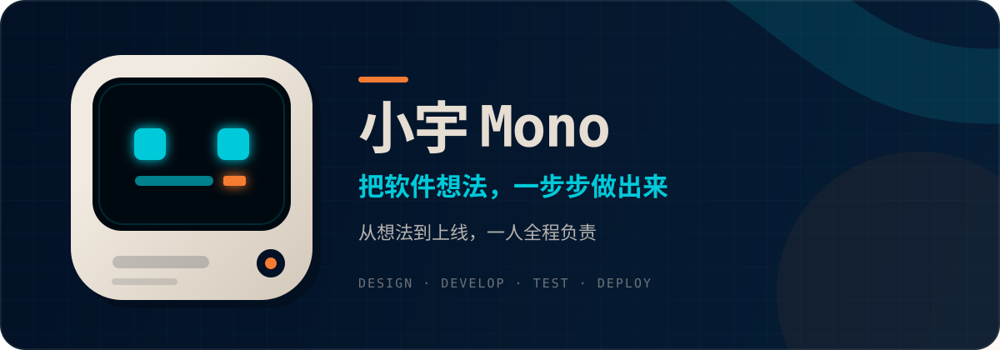

<p align="center">
  
</p>

<p align="center">
  <strong>从想法到上线，一人全程负责</strong>
</p>

<p align="center">
  <a href="https://github.com/RZDCXZ?tab=repositories">作品</a>
  ·
  <a href="https://why-myblog.vercel.app">博客</a>
  ·
  <a href="https://space.bilibili.com/252180571">B 站</a>
</p>

## 你好，我是小宇

我帮个人、创业者和小团队把软件想法一步步做出来。需求梳理、界面设计、开发、测试、部署，都由我本人负责，沟通不转手。

我重视清楚的范围、可验证的交付和长期可维护性。这里的非客户项目都会明确标注为演示项目，不用概念图冒充已经落地的产品。

## 精选作品

| 项目 | 解决的问题 | 状态 |
| --- | --- | --- |
| [GroundedDesk](https://github.com/RZDCXZ/grounded-desk) | 把企业知识变成有引用、会拒答、可持续改进的智能客服 | 演示项目 · 可在线访问 |
| [Torquelis 询盘运营](https://github.com/RZDCXZ/b2b-inquiry-site) | 双语产品目录、询盘管理、角色权限与可重复演示 | 演示项目 · 持续迭代 |
| [茸光宠物洗护](https://github.com/RZDCXZ/store-appointment) | 微信小程序、管理后台与 API 组成的预约排班系统 | 演示项目 · 持续迭代 |
| [批发经营台账](https://github.com/RZDCXZ/wholesale-ops) | 面向小型批发商的多角色账号管理与业务审计 | 演示项目 · 持续迭代 |

## 可以找我做

- 小程序、App、Web 网站与 Web 应用
- 管理后台、内部工具和各类实用小工具
- 已有软件修改、功能小改、Bug 修复与持续迭代
- 公开数据采集（爬虫）、数据清洗与定时自动化
- 部署上线、环境配置与后续维护

```text
需求梳理  →  原型与方案  →  分阶段开发  →  测试验收  →  部署维护
```

常用技术：`TypeScript` · `React` · `Next.js` · `Node.js` · `NestJS` · `PostgreSQL` · `Supabase` · `Docker` · `Playwright`

## 联系与合作

**免费咨询｜新客户首单有优惠**

如果你有软件想法，欢迎通过 [B 站私信](https://space.bilibili.com/252180571) 联系我。带上你想解决的问题、预算范围和期望时间，我会先帮你判断能否实现，以及适合从哪一步开始。

<p align="center">
  <sub>Independent software designer &amp; developer · Available for remote projects</sub>
</p>
